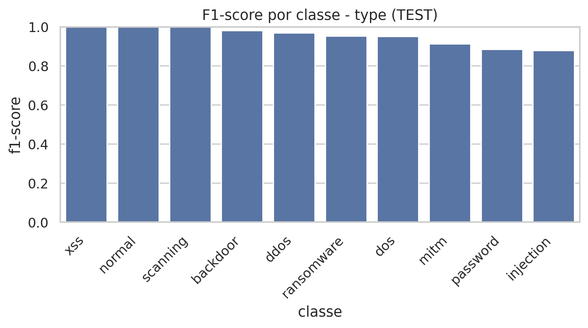
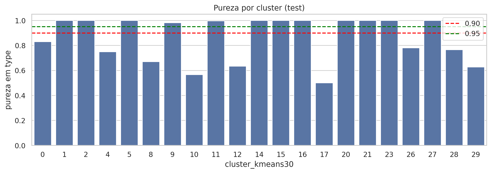

# SIA UFV 2026 — Arquitetura híbrida para detecção de tráfego malicioso em ambientes IoT

Repositório dedicado ao **trabalho 24615**, aprovado na modalidade **Pesquisa (Graduação)** do Simpósio de Integração Acadêmica (SIA) 2026 da Universidade Federal de Viçosa.

## Identificação

| Campo | Informação |
| --- | --- |
| Título aprovado | **Arquitetura híbrida para detecção de tráfego malicioso em ambientes IoT** |
| Autor | Matheus Antony Souza Pereira |
| Orientador | Vitor Barbosa Carlos de Souza |
| Instituição | Universidade Federal de Viçosa (UFV), Departamento de Informática |
| Área temática | ODS 9 — Indústria, Inovação e Infraestrutura |
| Modalidade | Pesquisa — Graduação |
| Bolsa | PIBIC/CNPq (2025–2026) |
| Apresentação | **21/10/2026, 10h30–12h**, Espaço Multiuso, painel **187** |

## Pesquisa apresentada

O trabalho investiga uma abordagem híbrida em **duas fases** para analisar tráfego IoT no contexto de computação em névoa:

1. **Não supervisionada:** descoberta de agrupamentos sem utilizar os rótulos de ataque.
2. **Supervisionada:** modelos Random Forest para predizer tráfego normal/malicioso (`label`), famílias de ataques (`type`) e agrupamentos (`cluster_kmeans30`).

O resumo aprovado abrange **211.043 conexões do TON_IoT** (50.000 normais e nove famílias de ataque). A separação de treino, validação e teste preserva grupos identificados pela **chave composta** `src_ip|dst_ip|service|proto`, sem interseção desses grupos entre as partições. O agrupamento principal emprega MiniBatch K-Means com `k=30`.

### Resultados do conjunto de teste

| Medida | Resultado |
| --- | ---: |
| AMI entre clusters e `type` | **0,6023** |
| AMI entre clusters e `label` | **0,3692** |
| Macro-F1 para `label` | **0,9993** |
| Macro-F1 para `type` | **0,9525** |
| Macro-F1 para `cluster_kmeans30` | **0,7648** |

**Efeito da divisão por grupos na predição dos clusters:** a macro-F1 da validação cruzada convencional foi 0,9993, versus **0,7967** na validação por grupos (e **0,7648** no teste por grupos). Essas métricas dizem respeito à tarefa `cluster_kmeans30`, não à classificação binária.

> **Escopo:** estudo experimental. Não houve implantação nem medição de latência fim a fim de um IDS em gateways reais. Outros experimentos da IC estão em seus próprios repositórios.

## Galeria de resultados

As figuras abaixo foram transferidas **diretamente dos resultados originais do SBCUP**, sem redesenho:

| F1 por família de ataque | Pureza dos clusters |
| --- | --- |
|  |  |

A [matriz de confusão completa por tipo de ataque](figuras/matriz-confusao-tipo.png) e as demais tabelas e figuras estão disponíveis, respectivamente, nesta pasta e no [repositório do experimento original](https://github.com/Math-BUG/iot-fog-ids-two-phase).

## Materiais

- [Resumo e identificação aprovados pelo SIA](docs/resumo-aprovado.md)
- [Painel do SIA: versões e instruções](apresentacao/README.md)
- [Imagens e proveniência](figuras/README.md)
- [Checklist de revisão científica, visual e financeira](docs/verificacao.md)

**Os arquivos binários do painel (PDF, PPTX, prévia PNG) ainda estão pendentes de envio a este repositório.** O documento e os metadados foram organizados antes da publicação da versão final.

## Repositórios relacionados

- [SBCUP 2026 — abordagem em duas fases (código e resultados originais)](https://github.com/Math-BUG/iot-fog-ids-two-phase)
- [ERAD-SE 2026 — desempenho CPU/GPU](https://github.com/Math-BUG/experimento_erad)
- [Generalização do IDS](https://github.com/Math-BUG/ids_generalization_pipeline)

## Links institucionais

- [Orientações para painel — SIA UFV](https://sia.ufv.br/apresentacao-painel/)
- [Template oficial SIA 2026](https://docs.google.com/presentation/d/1cVP83E9dWkTBsV7WaBNzIk81OuYaQ1qT2vRx7-e8H_M/edit)

**Privacidade:** não publicar o relatório final assinado, documentos cadastrais, certificados individuais nem dados brutos de tráfego.
