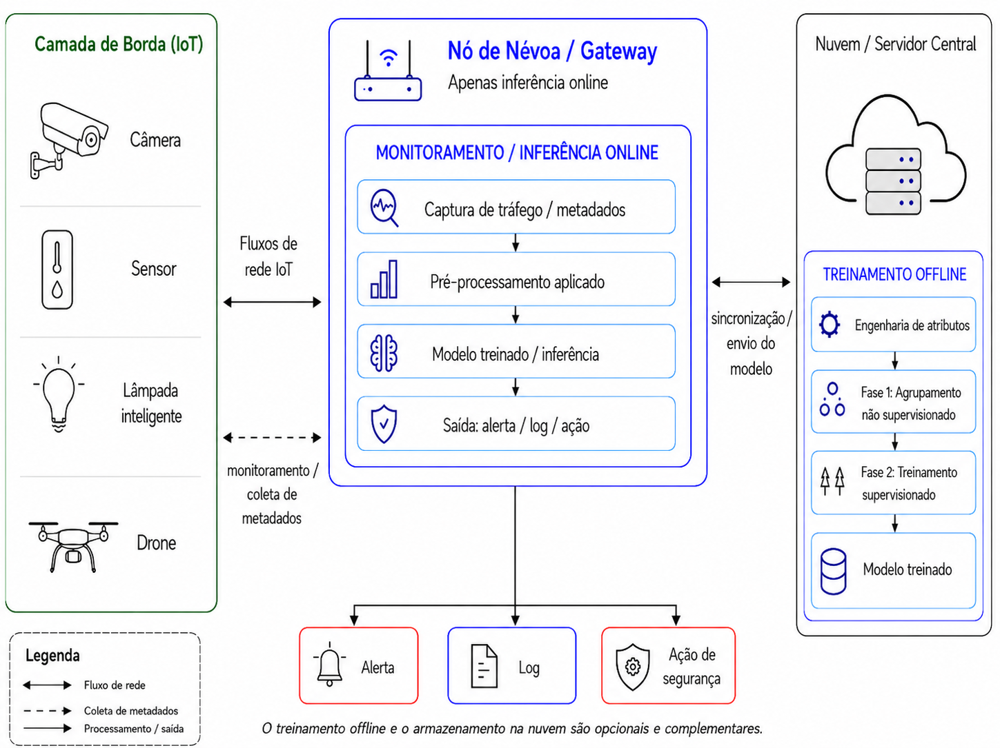

# SIA UFV 2026 — Arquitetura híbrida para detecção de tráfego malicioso em ambientes IoT

> **Trabalho 24615 · Pesquisa (Graduação) · PIBIC/CNPq · ODS 9**  
> Materiais de divulgação científica do trabalho aprovado no Simpósio de Integração Acadêmica (SIA) 2026 da Universidade Federal de Viçosa.

## Sobre o trabalho

Dispositivos de Internet das Coisas (IoT) frequentemente possuem limitações de memória e processamento. A pesquisa investiga o uso de aprendizado de máquina para identificar padrões de tráfego normal e malicioso, considerando a computação em névoa como contexto arquitetural para processamento próximo à rede monitorada.

O estudo possui **duas fases**:

1. **Não supervisionada:** agrupamento das conexões sem utilizar os rótulos de ataque no ajuste do modelo; comparação de MiniBatch K-Means, DBSCAN e agrupamento hierárquico.
2. **Supervisionada:** treinamento de Random Forest para predizer tráfego normal/malicioso (`label`), tipo de ataque (`type`) e os grupos obtidos com K-Means (`cluster_kmeans30`).

A avaliação utilizou **211.043 conexões** do TON_IoT, com **10 classes** (tráfego normal e nove famílias de ataque), e adotou a separação entre treino, validação e teste por grupos definidos pela chave composta `src_ip|dst_ip|service|proto`.

**O trabalho é experimental:** não houve implantação de um IDS em gateway real nem medição de latência fim a fim. Os resultados de generalização em escala maior pertencem a [outra etapa da pesquisa](https://github.com/Math-BUG/ids_generalization_pipeline).

## Resultados selecionados

| Métrica | Conjunto de teste |
| --- | ---: |
| AMI dos clusters em relação a `type` | **0,6023** |
| AMI dos clusters em relação a `label` | **0,3692** |
| Macro-F1 do Random Forest — `label` | **0,9993** |
| Macro-F1 do Random Forest — `type` | **0,9525** |
| Macro-F1 do Random Forest — `cluster_kmeans30` | **0,7648** |

Na tarefa de **predição de clusters**, a macro-F1 foi **0,9993** na validação cruzada convencional, **0,7967** na validação por grupos e **0,7648** no teste por grupos. Esse contraste mostra a importância de avaliar conexões relacionadas sem permitir a sobreposição da chave de grupo entre as partições.

| F1 por tipo de ataque | Pureza dos agrupamentos |
| --- | --- |
|  |  |

Outras figuras: [matriz de confusão por tipo](figuras/matriz-confusao-tipo.png) · [fontes e explicação das imagens](figuras/README.md).

## Apresentação no SIA 2026

| Informação | Detalhe |
| --- | --- |
| **Título aprovado** | **Arquitetura híbrida para detecção de tráfego malicioso em ambientes IoT** |
| **Primeiro autor** | Matheus Antony Souza Pereira |
| **Orientador** | Vitor Barbosa Carlos de Souza |
| **Instituição** | Departamento de Informática — Universidade Federal de Viçosa |
| **Categoria** | Pesquisa — Graduação |
| **ODS** | 9 — Indústria, Inovação e Infraestrutura |
| **Bolsa / apoio registrado** | PIBIC/CNPq |
| **Sessão programada** | 21/10/2026, 10h30–12h · Espaço Multiuso · Painel 187 |

### Materiais disponibilizados

- **[Painel em PDF — versão de revisão](apresentacao/painel-em-revisao.pdf)**
- **[PowerPoint editável — versão de revisão](apresentacao/painel-editavel-revisar.pptx)**
- **[Prévia do painel](apresentacao/visualizacao-painel.png)**
- [Resumo aprovado integralmente](docs/resumo-aprovado.md)
- [Informações sobre a apresentação e status das versões](apresentacao/README.md)
- [Cuidados e conferência antes da impressão](docs/verificacao.md)
- [Como citar o trabalho](docs/como-citar.md)

**Atenção:** os arquivos PDF e PPTX disponibilizados são versões de trabalho e **não devem ser presumidos idênticos ou finais para impressão**. O [checklist](docs/verificacao.md) registra ajustes metodológicos e de apresentação ainda necessários.

## Repositórios vinculados

Este repositório concentra a **divulgação no SIA**, sem duplicar código, dados e experimentos originais.

- **[SBCUP 2026 — abordagem em duas fases](https://github.com/Math-BUG/iot-fog-ids-two-phase):** notebooks, resultados, matrizes e figuras da pesquisa apresentada.
- **[ERAD-SE 2026 — custo computacional CPU/GPU](https://github.com/Math-BUG/experimento_erad):** experimentos de desempenho e scripts para clusters.
- **[Generalização de IDS](https://github.com/Math-BUG/ids_generalization_pipeline):** continuidade da IC, avaliações mais rigorosas e experimentos em maior escala.

## Fontes e informações adicionais

- [Orientações oficiais para apresentação em painel no SIA](https://sia.ufv.br/apresentacao-painel/)
- [Template oficial do SIA 2026](https://docs.google.com/presentation/d/1cVP83E9dWkTBsV7WaBNzIk81OuYaQ1qT2vRx7-e8H_M/edit)

Os arquivos disponibilizados contêm apenas material acadêmico de divulgação. O relatório final assinado, os documentos administrativos e os dados brutos de tráfego **não** fazem parte deste repositório. A disponibilização pública não implica concessão de licença irrestrita para redistribuição ou adaptação de materiais de terceiros.
