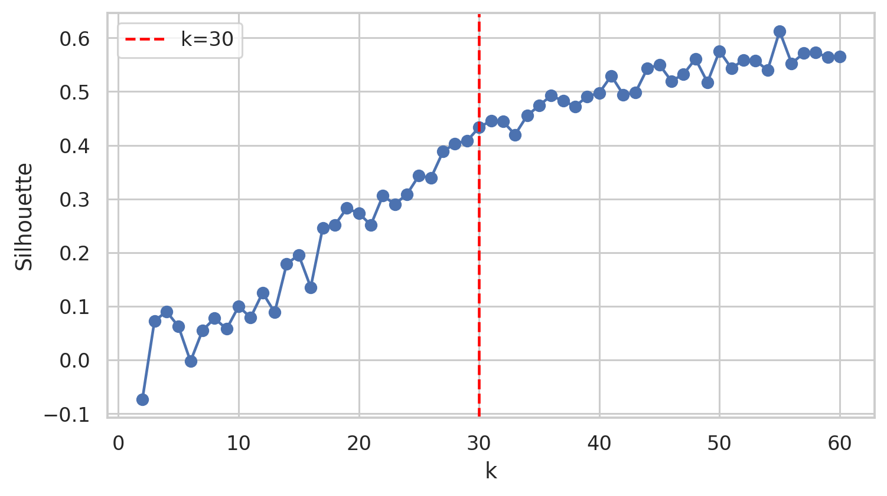
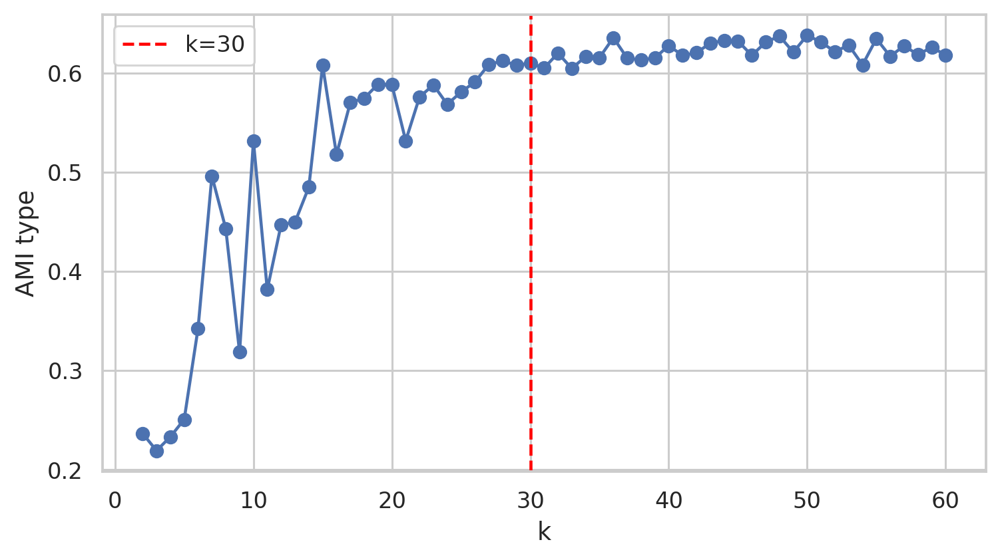
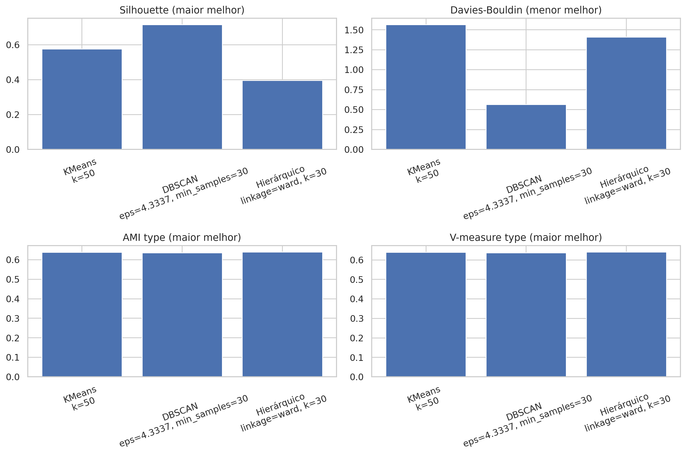
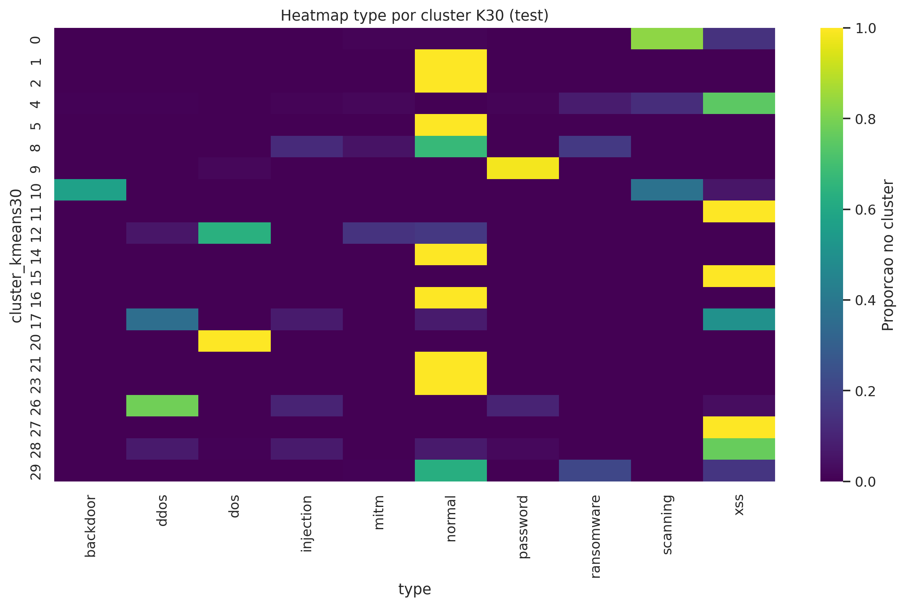
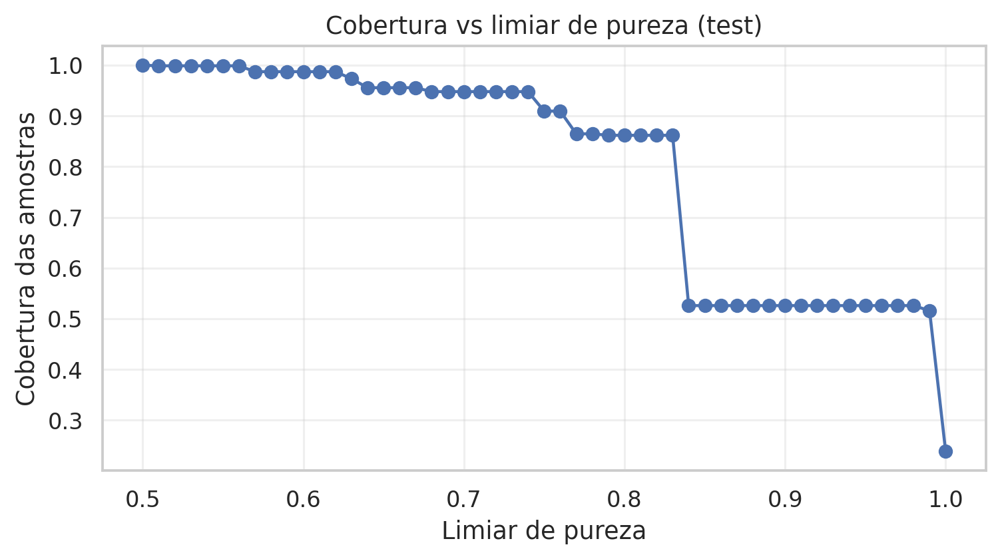
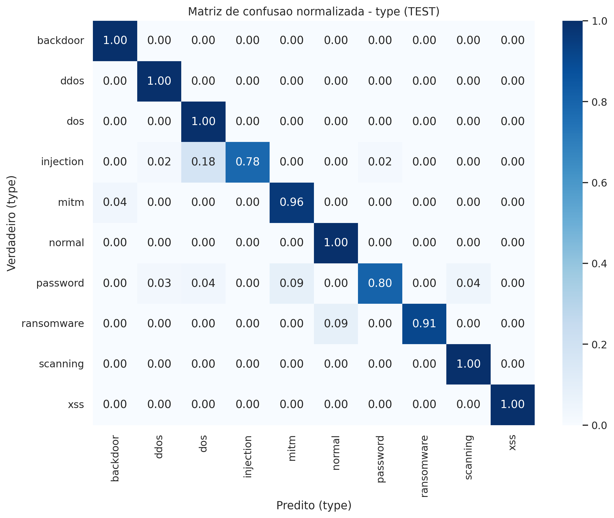
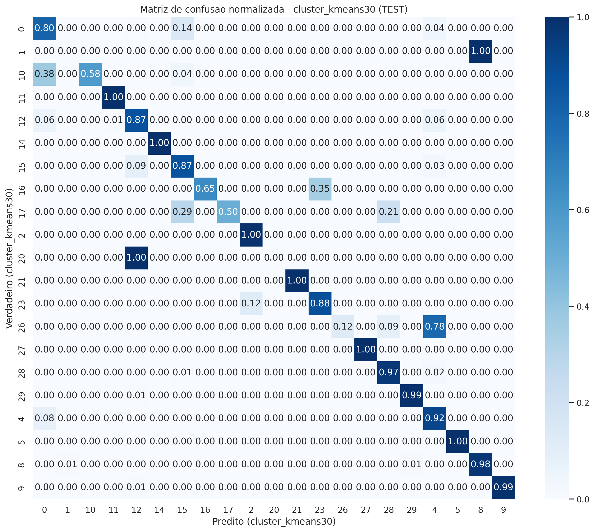
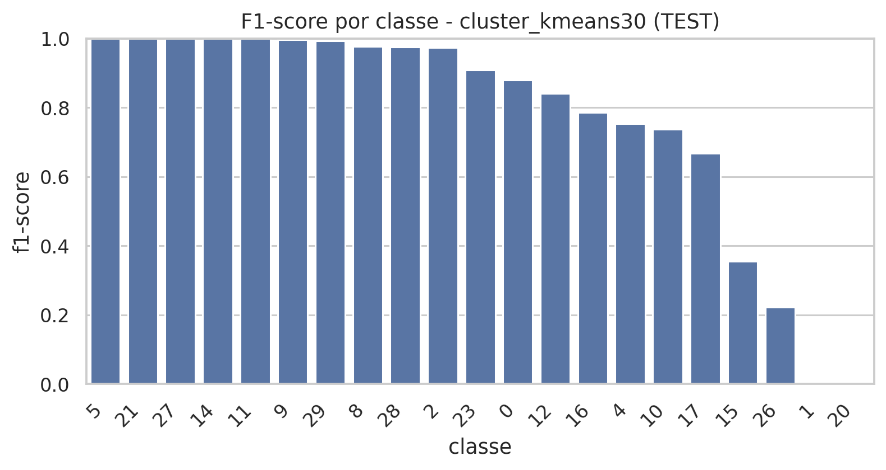

# Resultados experimentais

Este documento detalha os resultados associados ao trabalho **“Arquitetura híbrida para detecção de tráfego malicioso em ambientes IoT”**, aprovado para apresentação no SIA UFV 2026. Os valores e as imagens vêm dos experimentos da abordagem em duas fases documentada no [repositório do SBCUP](https://github.com/Math-BUG/iot-fog-ids-two-phase).

## Base de dados e avaliação

| Partição | Número de conexões |
| --- | ---: |
| Treino | 183.158 |
| Validação | 16.901 |
| Teste | 10.984 |
| **Total** | **211.043** |

O recorte TON_IoT contém **50.000 conexões normais** e nove famílias de ataques. A menor classe é **MITM**, com **1.043 amostras no total (0,49%)**. Os grupos foram definidos pela combinação de IP de origem, IP de destino, serviço e protocolo. Não houve sobreposição das **chaves compostas** entre as partições; isso não significa que cada endereço IP individual apareça em apenas uma partição.

Na etapa não supervisionada, `label` e `type` foram removidos da entrada antes da formação dos clusters. O pré-processamento utilizou codificação categórica, normalização e redução de dimensionalidade com Truncated SVD.

## Seleção do algoritmo e do número de clusters

Foram comparados K-Means, DBSCAN e agrupamento hierárquico. O **MiniBatch K-Means com `k = 30`** foi adotado pela combinação de alinhamento externo, escalabilidade, atribuição direta de novos pontos e ausência de amostras descartadas como ruído.

| Curva de silhouette por k | Alinhamento AMI por k |
| --- | --- |
|  |  |

**Nota sobre comparabilidade:** os valores e gráficos exploratórios foram gerados durante a escolha de algoritmos/configurações. Não devem ser confundidos com a avaliação final em validação e teste por grupos apresentada abaixo.

## Qualidade dos agrupamentos K-Means (k=30)

| Conjunto | Referência | ARI | AMI | V-measure |
| --- | --- | ---: | ---: | ---: |
| Validação | `type` | 0,5068 | 0,6920 | 0,6928 |
| Validação | `label` | 0,3828 | 0,4706 | 0,4708 |
| Teste | `type` | **0,5414** | **0,6023** | **0,6041** |
| Teste | `label` | 0,2327 | 0,3692 | 0,3696 |

O alinhamento com `type` foi estatisticamente significativo no teste de permutação (**200 permutações; p = 0,0050**). Essa evidência indica que os grupos capturam parte da estrutura dos tipos de tráfego, mas **não implica que cada cluster corresponda a uma única família de ataque**.

As análises de composição apontaram clusters com elevada pureza para alguns padrões de **DoS**, **backdoor** e tráfego **normal**; já **injection** mostrou maior mistura e **MITM** não apresentou agrupamento dominante no recorte avaliado.

| Pureza dos clusters | Cobertura sob diferentes limiares de pureza |
| --- | --- |
|  |  |

[CSV com métricas externas](metricas-externas-clustering.csv).

## Classificação supervisionada

O **Random Forest** foi avaliado em três tarefas, com a mesma separação por grupos. Os resultados obtidos nas partições de validação e teste são:

| Alvo | Conjunto | Acurácia | Macro-F1 | F1 ponderado | MCC |
| --- | --- | ---: | ---: | ---: | ---: |
| `label` | Validação | 0,9996 | 0,9996 | 0,9996 | 0,9992 |
| `label` | Teste | **0,9995** | **0,9993** | 0,9995 | 0,9987 |
| `type` | Validação | 0,9907 | 0,8592 | 0,9909 | 0,9877 |
| `type` | Teste | **0,9951** | **0,9525** | 0,9950 | 0,9928 |
| `cluster_kmeans30` | Validação | 0,9821 | 0,8328 | 0,9812 | 0,9773 |
| `cluster_kmeans30` | Teste | **0,9144** | **0,7648** | 0,9265 | 0,8977 |

O **macro-F1** calcula a média entre classes sem favorecer as mais frequentes. Por isso, a diferença entre macro-F1 e F1 ponderado revela fragilidade em classes/agrupamentos menos representados.

### Desempenho por tipo de ataque no teste

| Classe | F1 | Amostras no teste |
| --- | ---: | ---: |
| Backdoor | 0,9801 | 74 |
| DDoS | 0,9689 | 78 |
| DoS | 0,9504 | 134 |
| Injection | 0,8791 | 51 |
| MITM | 0,9133 | 82 |
| Normal | 0,9986 | 2.438 |
| Password | 0,8845 | 138 |
| Ransomware | 0,9530 | 78 |
| Scanning | 0,9981 | 3.164 |
| XSS | 0,9995 | 4.747 |

| F1 por família de ataque | Matriz de confusão da classificação de tipo |
| --- | --- |
|  |  |

O baixo alinhamento de **MITM na análise não supervisionada** não significa que o classificador supervisionado apresentou o mesmo problema: no teste, o F1 da tarefa `type` para MITM foi **0,9133**, embora baseado em apenas **82 observações**. Essas avaliações respondem a perguntas diferentes.

[CSV das métricas supervisionadas](metricas-supervisionadas.csv) · [CSV das métricas por tipo de ataque](metricas-por-tipo-teste.csv).

## Predição dos clusters e matriz de confusão

A tarefa `cluster_kmeans30` verifica se um Random Forest consegue **reproduzir as atribuições do K-Means**, e não se os clusters são semanticamente equivalentes aos rótulos de ataque.

**Matriz de confusão original do conjunto de teste:**

O K-Means foi ajustado com **30 clusters**, mas **21 deles aparecem no conjunto de teste**. Por isso, a matriz possui 21 classes observadas. Os clusters com poucos exemplos pesam mais na média macro: os clusters **1** e **20**, por exemplo, têm **2 observações de teste cada** e F1 igual a **0**. Os clusters **11** (3.040 observações) e **14** (1.166) tiveram F1 igual a **1,0000**.

A acurácia global nesta tarefa foi **0,9144**, mas o **macro-F1 foi 0,7648**. A matriz ajuda a identificar erros entre agrupamentos, em vez de mascará-los na acurácia geral.

Arquivos para conferência: [matriz de confusão em contagens (TEST)](matriz-confusao-clusters-k30-teste.csv) · [métricas por cluster](metricas-por-cluster-teste.csv).

## Por que a avaliação por grupos importa?

Na predição dos clusters foram observados:

| Protocolo | Macro-F1 |
| --- | ---: |
| Validação cruzada convencional (sem grupos) | **0,9993 ± 0,00039** |
| Validação cruzada por grupos | **0,7967 ± 0,1044** |
| Teste com separação por grupos | **0,7648** |

A validação convencional pode posicionar conexões relacionadas em diferentes partições, elevando artificialmente o desempenho medido. A diferença observada reforça a importância do protocolo de avaliação e da independência **da chave composta de agrupamento**, embora não demonstre generalização entre bases de dados distintas.

## Escopo e reprodutibilidade

Este repositório apresenta os **resultados do recorte inicial de 211.043 conexões**. O pipeline não foi implantado em gateways reais; a computação em névoa constitui o contexto arquitetural proposto. Experimentos posteriores com mais de 22 milhões de registros, seleção de atributos mais restrita e novas configurações estão documentados no [repositório de generalização](https://github.com/Math-BUG/ids_generalization_pipeline) e não devem ser diretamente comparados como se apenas o volume de dados tivesse mudado.

**Fontes principais:** [notebooks](https://github.com/Math-BUG/iot-fog-ids-two-phase/tree/main/codigo), [gráficos](https://github.com/Math-BUG/iot-fog-ids-two-phase/tree/main/gr%C3%A1ficos) e [tabelas CSV originais](https://github.com/Math-BUG/iot-fog-ids-two-phase/tree/main/resultados). Os CSVs incluídos aqui são cópias de consulta da avaliação original, sem recálculo das métricas.
